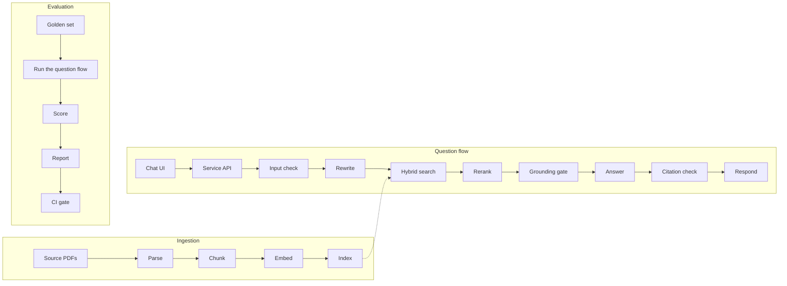

# cfa-rag

An ask-my-docs chat application for CFA Level I study notes. It answers a question from the notes,
cites the passage behind every statement, and says so plainly when the notes do not support an
answer. Quality and resistance to prompt injection are measured, and the numbers are published.

The question-serving path is built twice, first in Python and then again in Rust, behind one HTTP
API and judged by one eval harness.

## Status

| # | Milestone | State |
|---|---|---|
| 0 | Public foundation: documentation, parser bake-off, first golden questions, retrieval metric | In progress |
| 1 | Walking skeleton: ingest, cited answer in a chat UI, tracing | Not started |
| 2 | Retrieval quality and conversations: hybrid search, rerank, follow-up questions | Not started |
| 3 | Evals and safety in CI: larger golden set, attack set, quality gate | Not started |
| 4 | Rust serving path, compared with the Python one | Not started |
| 5 | Later: Claude API, other loaders, React UI | Not started |

Document parser: being chosen by a bake-off on twenty pages. No quality numbers exist yet.

## How it works



Three steps can stop and refuse: the input check, the grounding gate and the citation check. The
last one verifies in code that every statement points to a passage that was actually retrieved.

[Open the interactive version](https://mingjun6886.github.io/cfa-rag/flow.html) to see what each
step does, which technology it uses and what the alternatives were.

## Run it

```bash
uv sync
uv run pytest
```

The pipeline is not built yet; for now this runs the test suite only.

## Documents

- [Design](docs/design.md): goals, non-goals, the three flows, milestones.
- [Technology trade-offs](docs/tech-decisions.md): every option considered, what it gives and costs.
- [Conventions](docs/conventions.md): how code, configuration and prompts are written.

## About the data

The study notes (SchweserNotes, CFA Level I 2024) are copyrighted and are not in this repository.
[`sample/`](sample/time-value-of-money.md) holds a short original primer on the time value of money,
written for this repository and MIT-licensed, so anyone can run the system without the notes. The golden
questions are written in the author's own words with page references only.
